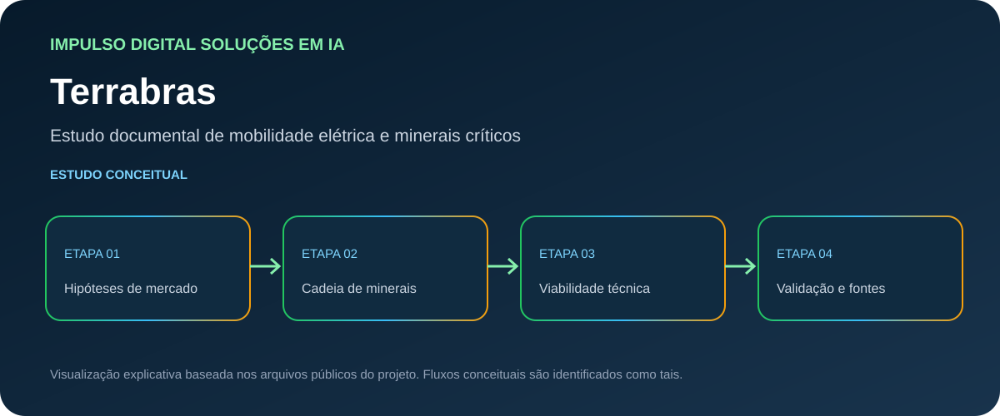

# Terrabras | Proposta de mobilidade elétrica e cadeia de valor mineral

<p align="center"></p>


Repositório de documentação conceitual sobre uma iniciativa de mobilidade elétrica brasileira e a possibilidade de desenvolver uma cadeia nacional de valor associada a minerais críticos.

> **Maturidade e transparência:** o conteúdo versionado consultado é documental. Este repositório não comprova a existência de fábrica, veículos homologados, operações de mineração, contratos de fornecimento, parcerias industriais ou produção comercial. As descrições de missão e visão abaixo representam objetivos propostos, não resultados alcançados.

## Objetivo

Estruturar hipóteses e materiais de pesquisa sobre:
- mobilidade elétrica e seus requisitos industriais;
- cadeia de suprimentos de minerais críticos;
- beneficiamento, manufatura e agregação de valor no Brasil;
- sustentabilidade, rastreabilidade e viabilidade econômica;
- riscos técnicos, regulatórios, ambientais e de mercado.

## Conteúdo do repositório

```text
Terrabras/
├── README.md
└── docs/
    ├── whitepaper.md
    └── analise_mercado.md
```

- `docs/whitepaper.md`: visão estratégica e hipóteses sobre cadeia de valor e soberania mineral.
- `docs/analise_mercado.md`: análise preliminar de mercado, oportunidades, desafios e matriz SWOT.

## Abordagem de análise

O material deve ser tratado como estudo preliminar. Afirmações sobre reservas minerais, mercado, empresas, tecnologia e políticas públicas precisam de fontes primárias atuais e verificáveis antes de serem usadas em decisões de investimento ou comunicação institucional.

## Como contribuir

1. Cite a fonte e a data de cada dado de mercado.
2. Separe fatos confirmados, estimativas e hipóteses.
3. Não apresente projeções como resultados realizados.
4. Registre premissas, metodologia e limitações.
5. Submeta revisões por pull request.

## Próximas etapas sugeridas

- Atualizar referências com fontes governamentais, científicas e setoriais.
- Desenvolver um estudo de viabilidade técnica e econômica.
- Mapear requisitos de homologação veicular e licenciamento ambiental.
- Estimar CAPEX, OPEX, cadeia de fornecedores e cenários de escala.
- Validar as hipóteses com especialistas independentes.

## Licença

Consulte [LICENSE](LICENSE), se presente, e verifique direitos de terceiros antes de reutilizar materiais. A documentação não constitui oferta de investimento, compromisso de fabricação ou garantia de desempenho.


**Empresa responsável:** Impulso Digital Soluções em IA.
